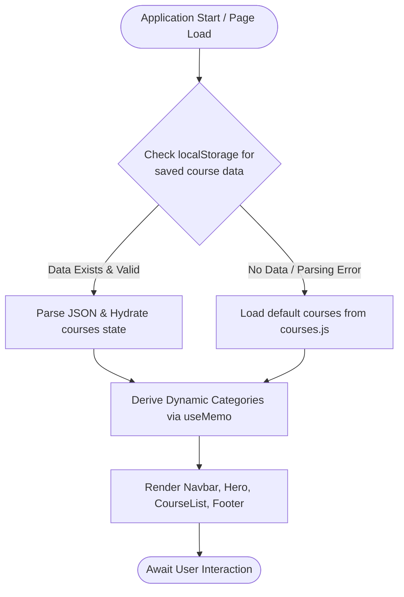
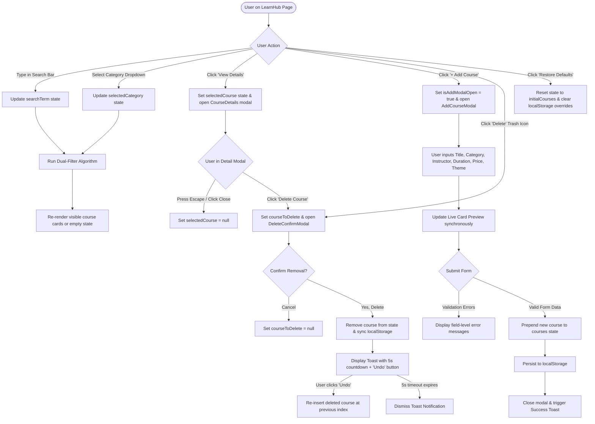

# FULL STACK DEVELOPMENT PROJECT REPORT

---

## **PROJECT TITLE: LearnHub — Interactive Online Course Catalog Web Application**

**Course:** Full Stack Web Development  
**Academic Year:** 2025–2026  
**Technology Stack:** React 19, JavaScript (ES6+), Vite 7, HTML5, CSS3, Browser Web Storage API (LocalStorage)  

---

## 1. Problem Statement

With the rapid expansion of digital education, learners often face fragmented learning platforms cluttered with complex navigation, intrusive registration walls, and sluggish interfaces. Finding a suitable course requires evaluating multiple parameters simultaneously—including subject category, duration, skill level, pricing, and instructor credibility. 

Many contemporary e-learning portals suffer from the following challenges:
1. **Inefficient Filtering and Search:** Users often endure cumbersome full-page reloads and multi-step forms just to discover relevant topics or filter out courses outside their budget or skill level.
2. **Lack of Instant Feedback:** Educational catalogs frequently lack real-time search responsiveness and live visual feedback when browsing or adding curriculum content.
3. **Rigid Catalog Management:** Traditional lightweight sample catalogs are static and read-only, preventing users and administrators from dynamically adding custom courses, categorizing new subjects, or curating catalog listings directly from the client interface.
4. **Destructive Actions Without Safeguards:** Accidental deletions in catalog systems often lead to immediate data loss without confirmation dialogues or undo capabilities.

**LearnHub** addresses these challenges by delivering a responsive, client-side Single-Page Application (SPA) engineered with modern component-based architecture. It provides instant, non-blocking search and dual-criterion category filtering, dynamic course creation with real-time card previews, safe deletions with two-step verification and undo actions, and persistent local storage—all within an accessible, modern user interface.

---

## 2. Abstract

**LearnHub** is an interactive, responsive online course catalog application designed to simplify the discovery and management of educational resources. The primary objective of the project is to implement a high-performance, accessible, and intuitive front-end architecture that demonstrates the core principles of full stack and modern client-side web development.

The proposed solution is built with **React 19** and bundled with **Vite 7**, leveraging a declarative, component-driven design. The application features:
- A seed dataset across diverse domains (Web Development, Programming, Data Science, Design, and Developer Tools).
- A **real-time search engine** that matches course titles in a case-insensitive manner concurrently with dropdown category filtering.
- **Dynamic catalog customization (CRUD operations)** enabling users to add new courses with custom categories, accent color themes, and emoji icons, complete with a live card preview.
- **Robust data persistence** using the browser's `localStorage` API to ensure state retention across browser sessions with zero backend configuration overhead.
- **Defensive user experience design**, including modal dialogs, accessible keyboard controls (`Escape` key listeners), confirmation dialogs for destructive actions, and time-expiring toast notifications with an interactive undo mechanism.

By combining modern UI/UX design patterns, dynamic state management through React Hooks (`useState`, `useEffect`, `useMemo`), and pure CSS responsive styling, LearnHub demonstrates how client-side engineering can deliver an engaging e-learning experience.

---

## 3. Algorithm & Methodology

The application follows an iterative development lifecycle combining reactive state management, functional component decomposition, and asynchronous event-driven state updates.

### 3.1 Step-by-Step Development Methodology
1. **Requirement Analysis & Data Modeling:** Define course entities with properties (`id`, `title`, `category`, `instructor`, `duration`, `level`, `price`, `icon`, `accent`, `description`).
2. **Component Architecture Design:** Break the interface down into modular, single-responsibility React functional components (`Navbar`, `Hero`, `CourseList`, `CourseCard`, `CourseDetails`, `AddCourseModal`, `DeleteConfirmModal`, `Toast`, `About`, `Footer`).
3. **State Management & Hydration:** Implement central state in the parent orchestrator (`App.jsx`). Read initially from `localStorage` if available; otherwise, fall back to default seed data (`courses.js`).
4. **Dual-Predicate Filtering Algorithm:** Implement computed filtering to filter the active course list simultaneously by category match and search query substrings.
5. **Dynamic Category Resolution:** Dynamically extract and deduplicate unique categories whenever new courses are added, updating dropdowns across the application automatically.
6. **Form Validation & Live Card Preview:** Build a controlled-input form inside a modal that performs synchronous validation while updating an interactive preview card in real time.
7. **Safe Deletion & Undo Stack Algorithm:** Use a two-phase deletion process: user confirmation modal followed by catalog removal, with the previous state preserved in a temporary undo closure linked to an auto-dismissing toast.

---

### 3.2 Core Algorithmic Procedures

#### Algorithm 1: Real-Time Dual-Criterion Course Filtering
```text
Input: Course Catalog Array C, Search Query String S, Selected Category Filter F
Output: Visible Course Array V

1. Sanitize Search Query: S_clean = trim(toLowerCase(S))
2. Initialize Empty List V = []
3. For each course c in C:
     a. MatchTitle = toLowerCase(c.title).contains(S_clean)
     b. MatchCategory = (F == "All Courses") OR (c.category == F)
     c. If MatchTitle AND MatchCategory:
          Append c to V
4. Return V
```

#### Algorithm 2: Dynamic Category Derivation
```text
Input: Default Categories D, Course Catalog Array C
Output: Unique Category Array U

1. Initialize Hash Set: CategorySet = new Set(D)
2. For each course c in C:
     If c.category is not null and not empty:
         CategorySet.add(c.category)
3. Convert CategorySet to Array: U = Array.from(CategorySet)
4. Return U
```

#### Algorithm 3: Safe Course Deletion with Reversible Undo
```text
Input: Target Course to Delete c_target, Course Catalog Array C
Output: Updated Catalog C_new, Active Toast with Undo Callback

1. Find original index: targetIndex = indexOf(c_target in C)
2. Filter list: C_new = C.filter(c => c.id != c_target.id)
3. Update state: Set C = C_new
4. Close Details Modal if open: If selectedCourse.id == c_target.id, set selectedCourse = null
5. Define Undo Callback:
     UndoAction = () => {
         Insert c_target back into C at targetIndex
         Trigger Success Toast("Restored course to catalog")
     }
6. Dispatch Toast Notification(message: "Course was deleted", undoAction: UndoAction, duration: 5000ms)
7. Synchronize C_new to LocalStorage
```

---

## 4. Flowcharts

### 4.1 Application Initialization & Lifecycle Flowchart



---

### 4.2 User Interaction, Search, CRUD & Modal Flowchart



---

## 5. System Modules & Architecture

LearnHub is structured as a modular single-page React application adhering to separation of concerns.

```text
online-course-catalog/
├── index.html                 # Single Page Application HTML5 entry point & metadata
├── package.json               # Project manifest, scripts, and dependencies (React 19, Vite)
├── vite.config.js             # Vite configuration with React fast refresh plugin
└── src/
    ├── main.jsx               # React DOM root render & StrictMode wrapper
    ├── index.css              # Global design system, variables, responsive typography & grid
    ├── App.jsx                # Root component, central state store, and business logic
    ├── data/
    │   └── courses.js         # Initial mock database and default category seeds
    └── components/
        ├── Navbar.jsx         # Site navigation bar with branding & quick action button
        ├── Hero.jsx           # Hero banner with branding, graphics & integrated search bar
        ├── CourseList.jsx     # Catalog section, topic filters, grid layout & empty states
        ├── CourseCard.jsx     # Individual course presentation card with color accents
        ├── CourseDetails.jsx  # Detailed course modal with backdrop click and Escape handler
        ├── AddCourseModal.jsx # Course creation form with live preview & input validation
        ├── DeleteConfirmModal.jsx # Safeguard modal for confirming destructive deletions
        ├── Toast.jsx          # Auto-dismissing notification banner with reversible undo
        ├── About.jsx          # Descriptive information section about the learning philosophy
        └── Footer.jsx         # Site footer containing copyright and navigation anchors
```

### Module Descriptions

| Module / Component | File Path | Primary Function & Responsibilities |
| :--- | :--- | :--- |
| **Root Application Controller** | [`App.jsx`](file:///c:/Users/HP/Downloads/online-course-catalog/src/App.jsx) | Maintains global states (`courses`, `searchTerm`, `selectedCategory`, `selectedCourse`, `isAddModalOpen`, `courseToDelete`, `toast`). Handles LocalStorage synchronization, executes search/category filtering, and coordinates CRUD actions. |
| **Data Seed Module** | [`courses.js`](file:///c:/Users/HP/Downloads/online-course-catalog/src/data/courses.js) | Supplies default course dataset (8 sample courses) across Web Development, Programming, Data Science, Design, and Tools, along with fallback categories. |
| **Navigation Header** | [`Navbar.jsx`](file:///c:/Users/HP/Downloads/online-course-catalog/src/components/Navbar.jsx) | Displays application brand identity (`LearnHub.`), internal anchor links, and primary CTA to open the course creation modal. |
| **Hero & Search Banner** | [`Hero.jsx`](file:///c:/Users/HP/Downloads/online-course-catalog/src/components/Hero.jsx) | Presents the hero headline, learner illustration, and main interactive search bar connected to `searchTerm` state. |
| **Course Catalog Section** | [`CourseList.jsx`](file:///c:/Users/HP/Downloads/online-course-catalog/src/components/CourseList.jsx) | Houses the category `<select>` dropdown, course counter, courses grid, empty states (for zero search matches or completely cleared catalogs), and reset triggers. |
| **Course Card Component** | [`CourseCard.jsx`](file:///c:/Users/HP/Downloads/online-course-catalog/src/components/CourseCard.jsx) | Renders course card with dynamic accent styling, category badge, emoji icon, duration, level, instructor, price badge, delete trigger, and modal open button. |
| **Course Details Modal** | [`CourseDetails.jsx`](file:///c:/Users/HP/Downloads/online-course-catalog/src/components/CourseDetails.jsx) | Full-screen backdrop dialog showcasing comprehensive course details (full description, duration, price, level, instructor) with keyboard accessibility. |
| **Course Creation Modal** | [`AddCourseModal.jsx`](file:///c:/Users/HP/Downloads/online-course-catalog/src/components/AddCourseModal.jsx) | Multi-input modal dialog with real-time field validation, custom category addition, emoji picker, accent color palette selector, price toggles, and a live card preview. |
| **Delete Confirmation Modal** | [`DeleteConfirmModal.jsx`](file:///c:/Users/HP/Downloads/online-course-catalog/src/components/DeleteConfirmModal.jsx) | Defensive confirmation barrier that displays course summary before executing irreversible removal from state. |
| **Interactive Toast Banner** | [`Toast.jsx`](file:///c:/Users/HP/Downloads/online-course-catalog/src/components/Toast.jsx) | Accessible status announcement component (`role="status"`, `aria-live="polite"`) featuring a 5-second auto-dismiss timer and an interactive "Undo" action. |
| **About & Footer Sections** | [`About.jsx`](file:///c:/Users/HP/Downloads/online-course-catalog/src/components/About.jsx), [`Footer.jsx`](file:///c:/Users/HP/Downloads/online-course-catalog/src/components/Footer.jsx) | Contextual information, motivational copy, copyright indicators, and secondary navigation links. |

---

## 6. Sample Code Snippets

The following code excerpts highlight the critical functional implementations within the project.

### 6.1 State Management & LocalStorage Persistence ([`App.jsx`](file:///c:/Users/HP/Downloads/online-course-catalog/src/App.jsx#L16-L43))
```javascript
const STORAGE_KEY = 'learnhub_courses_catalog'

export default function App() {
  // Initialize state with resilient LocalStorage reading
  const [courses, setCourses] = useState(() => {
    try {
      const saved = localStorage.getItem(STORAGE_KEY)
      if (saved) {
        const parsed = JSON.parse(saved)
        if (Array.isArray(parsed)) return parsed
      }
    } catch (e) {
      console.warn('Failed to parse saved courses from localStorage', e)
    }
    return initialCourses
  })

  // Synchronize state changes automatically to Web Storage
  useEffect(() => {
    try {
      localStorage.setItem(STORAGE_KEY, JSON.stringify(courses))
    } catch (e) {
      console.error('Failed to save courses to localStorage', e)
    }
  }, [courses])
  
  // ...
```

---

### 6.2 Dual-Criterion Filtering & Dynamic Categories ([`App.jsx`](file:///c:/Users/HP/Downloads/online-course-catalog/src/App.jsx#L46-L65))
```javascript
  // Compute dynamic category list: defaults + any newly added categories
  const dynamicCategories = useMemo(() => {
    const set = new Set(defaultCategories)
    courses.forEach(c => {
      if (c.category) set.add(c.category)
    })
    return Array.from(set)
  }, [courses])

  // Filter courses by search term and selected category simultaneously
  const visibleCourses = courses.filter((course) => {
    const matchesTitle = course.title
      .toLowerCase()
      .includes(searchTerm.trim().toLowerCase())
    const matchesCategory =
      selectedCategory === 'All Courses' || course.category === selectedCategory
    return matchesTitle && matchesCategory
  })
```

---

### 6.3 Safe Deletion with Undo Callback Closure ([`App.jsx`](file:///c:/Users/HP/Downloads/online-course-catalog/src/App.jsx#L87-L113))
```javascript
  function handleConfirmDelete(course) {
    const deletedIndex = courses.findIndex(c => c.id === course.id)
    setCourses(prev => prev.filter(c => c.id !== course.id))

    if (selectedCourse?.id === course.id) {
      setSelectedCourse(null)
    }
    setCourseToDelete(null)

    // Offer undo functionality via temporary state closure
    setToast({
      message: `Course "${course.title}" was deleted.`,
      type: 'delete',
      undoAction: () => {
        setCourses(prev => {
          const updated = [...prev]
          const targetIndex =
            deletedIndex >= 0 && deletedIndex <= prev.length ? deletedIndex : 0
          updated.splice(targetIndex, 0, course)
          return updated
        })
        setToast({
          message: `Restored "${course.title}" to catalog.`,
          type: 'success'
        })
      }
    })
  }
```

---

### 6.4 Client-Side Form Validation & Creation ([`AddCourseModal.jsx`](file:///c:/Users/HP/Downloads/online-course-catalog/src/components/AddCourseModal.jsx#L77-L108))
```javascript
  function validate() {
    const newErrors = {}
    if (!title.trim()) newErrors.title = 'Course title is required'
    if (isCustomCategory && !customCategory.trim())
      newErrors.category = 'Please enter a category name'
    if (!instructor.trim()) newErrors.instructor = 'Instructor name is required'
    if (!duration.trim()) newErrors.duration = 'Course duration is required'
    if (!isFree && !priceNumber.trim())
      newErrors.price = 'Please specify a price or select Free'
    if (!description.trim()) newErrors.description = 'Course description is required'
    
    setErrors(newErrors)
    return Object.keys(newErrors).length === 0
  }

  function handleSubmit(e) {
    e.preventDefault()
    if (!validate()) return

    const newCourse = {
      id: Date.now(),
      title: title.trim(),
      category: resolvedCategory || 'General',
      instructor: instructor.trim(),
      duration: duration.trim(),
      level,
      price: resolvedPrice,
      icon: icon.trim() || '📚',
      accent,
      description: description.trim()
    }

    onAddCourse(newCourse)
    onClose()
  }
```

---

### 6.5 Accessible Keyboard Navigation & Modal Dismissal ([`CourseDetails.jsx`](file:///c:/Users/HP/Downloads/online-course-catalog/src/components/CourseDetails.jsx#L4-L24))
```javascript
export default function CourseDetails({ course, onClose, onDelete }) {
  useEffect(() => {
    function handleKeyDown(e) {
      if (e.key === 'Escape' && course) {
        onClose()
      }
    }
    window.addEventListener('keydown', handleKeyDown)
    return () => window.removeEventListener('keydown', handleKeyDown)
  }, [course, onClose])

  if (!course) return null

  return (
    <div
      className="modal-backdrop"
      role="presentation"
      onMouseDown={(event) => {
        if (event.target === event.currentTarget) onClose()
      }}
    >
      <section className="course-modal" role="dialog" aria-modal="true">
        {/* Modal content */}
      </section>
    </div>
  )
}
```

---

## 7. Conclusion

The **LearnHub** project demonstrates the design and practical implementation of an interactive, client-side web application for modern online education cataloging. Developed for the Full Stack Web Development course, the project successfully achieves all stated design and technical objectives:

### Key Outcomes & Findings:
1. **Component-Driven Reusability:** Breaking down the interface into focused functional components (`CourseCard`, `CourseDetails`, `AddCourseModal`, etc.) allowed clean separation of presentation from business logic and simplified state synchronization.
2. **Predictable State & Persistence:** Utilizing React hooks (`useState`, `useEffect`, `useMemo`) combined with browser Web Storage (`localStorage`) created a resilient user experience where course modifications, additions, and deletions persist across page reloads without requiring an external database setup.
3. **Advanced UX & Defensive Engineering:** Implementing features such as live form previews, field-level validation, multi-criteria filtering, modal escape listeners, two-step deletion confirmation, and non-destructive toast notifications with undo actions elevated the project from a simple static catalog to an intuitive web platform.
4. **Performance & Standards Compliance:** By avoiding heavy third-party UI libraries in favor of native CSS3 Grid, Flexbox, custom design tokens, and semantic HTML5, the application achieves rapid load times, smooth transitions, and high accessibility standards (`aria-*` compliance).

### Overall Learning:
Through the development of LearnHub, comprehensive hands-on competency was gained in modern JavaScript (ES6+), React 19 lifecycle and hooks, declarative UI state modeling, responsive CSS layout techniques, and human-centered defensive interface design. The project serves as an extensible foundation that can readily be integrated with RESTful or GraphQL backends in future full stack iterations.
